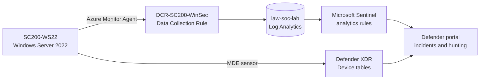

# Sentinel-SOC-Lab-Detecting-Triaging-and-Hunting-Attacks-with-Microsoft-Sentinel-and-Defender-XDR


Sentinal-SOC Lab is a hands-on SOC lab I built on Azure while preparing for the Microsoft SC-200 (Security Operations Analyst) exam. I deployed a Windows Server 2022 VM, streamed its security logs into Microsoft Sentinel, wrote custom detections mapped to MITRE ATT&CK, simulated attacks against the VM, and investigated the resulting incidents in the Microsoft Defender portal using KQL.

**Tools:** Microsoft Sentinel, Microsoft Defender XDR, Microsoft Defender for Endpoint, Defender for Cloud, Azure Monitor Agent, Log Analytics, KQL, PowerShell
**Built:** September 2026

---

## Architecture



| Component | Detail |
|---|---|
| Target host | `SC200-WS22`, Windows Server 2022 Datacenter, Standard B2als_v2, India South Central |
| Workspace | `law-soc-lab` (Log Analytics with Microsoft Sentinel) |
| Log collection | Azure Monitor Agent with data collection rule `DCR-SC200-WinSec`, "Common" Windows security event set |
| Endpoint protection | Defender for Servers Plan 2, host onboarded to Defender for Endpoint |
| Access control | RDP allowed from a single source IP through a dedicated NSG rule |


---

## What I built

### 1. Log pipeline
I installed the Windows Security Events solution, created a data collection rule, and attached the VM so the Azure Monitor Agent forwards security events to the workspace. I chose the "Common" event set to keep ingestion small, and verified delivery with `SecurityEvent` queries.

### 2. Custom detections
I wrote two scheduled analytics rules, each with MITRE mapping, entity mapping (Host and Account), and incident creation.

| Rule | Severity | MITRE | Logic |
|---|---|---|---|
| SC200 - Brute force failed logons | Medium | T1110 | 5 or more failed logons (event 4625) for the same account on a host, every 5 minutes over a 10-minute window |
| SC200 - New local admin created | High | T1136.001 | Local account creation (4720) or a member added to the local Administrators group (4732) |


### 3. Microsoft Defender for Endpoint integration
I enabled Defender for Servers (Plan 2) as the only paid plan, and the `MDE.Windows` extension deployed to the VM. The host appears in Device Inventory as a Windows Server. I created a device group, `SC200-Lab-Servers`, with the rule *Name starts with `SC200`* and the remediation level **Semi - Approval required for all folders**, so any Defender remediation needs analyst approval. I confirmed membership with `DeviceInfo`, and alerts now show the device with its group label.


---

## Incident walkthroughs

### Incident 1: Brute force against a local account (T1110)
**Simulation.** I ran eight failed network logons against a non-existent account, `labfake`, using `net use`.

**Detection.** *SC200 - Brute force failed logons* fired and created a Medium-severity incident.

**Investigation.**
- The alert evidence showed 8 failures for `labfake` on `SC200-WS22`, matching the simulation.
- The source IP was `::1` (localhost), which is expected for a self-generated test.
- The Assets tab and attack-story graph linked the host and the account.
- In Advanced hunting I confirmed the raw 4625 events and their logon type (type 3, network).

**Outcome.** Classified as *Informational, expected activity: Security testing*, with a comment documenting the test.

```kql
SecurityEvent
| where TimeGenerated > ago(30m)
| where EventID == 4625
| summarize Failures = count() by TargetUserName, Computer
```


### Incident 2: New local administrator (T1136.001)
**Simulation.** I created a local account, `labtemp`, and added it to the Administrators group.

**Detection.** *SC200 - New local admin created* fired and created a High-severity Persistence incident.

**Investigation.**
- The alert's account entity was `azure`, the account that *performed* the change, and the evidence row showed event 4732 for the `Administrators` group.
- The new account name was not in the alert evidence, so I pivoted to Advanced hunting and pulled events 4720 and 4732 together with their SID fields.
- Matching the 4720 `TargetSid` to the 4732 `MemberSid` tied `labtemp` to the privileged group change.
- A second 4732 event for the `Users` group was the default group membership every new local account receives, so I treated it as benign.

**Outcome.** Classified as *Informational, expected activity: Security testing*. I deleted the test account afterwards and verified with `net user`.

```kql
SecurityEvent
| where EventID in (4720, 4732)
| project TimeGenerated, EventID, Activity, TargetUserName, TargetSid,
          SubjectUserName, MemberName, MemberSid
| order by TimeGenerated desc
```


---

## Results

| Simulated technique | MITRE | Detected | Evidence |
|---|---|---|---|
| Repeated failed logons against a fake account | T1110 | Yes | Sentinel alert and incident, 8 failures in the evidence |
| Local account creation and admin group addition | T1136.001 | Yes | Sentinel alert and incident, events 4720 and 4732 |

Both simulated techniques produced alerts and incidents, and I investigated and classified each one.

---

## Lessons learned

- **Entity mapping decides how useful an incident is.** My first brute-force rule mapped the username into the *Host* entity. Moving it to its own *Account* entity made the incident graph and the Assets tab show the host and the target account correctly.
- **Alert evidence needs the right fields.** The admin-creation alert identified who made the change but not who was added. Including `MemberSid` in the rule's output would put the new account in the alert itself, saving the extra hunting step.
- **Repeated test runs create repeated alerts.** Running the same attack more than once produced separate alerts. Alert grouping or suppression would reduce that noise in a real SOC.
- **Self-generated logons look different.** Local test logons show `::1` as the source address, unlike real remote activity, so my brute-force rule did not rely on source IP.
- **Portal differences matter.** Sentinel Logs use `TimeGenerated`, while Defender Advanced hunting tables use `Timestamp`. Checking which table family I'm querying first avoids silent query failures.

## Security and cost controls

- RDP restricted to a single source IP with its own NSG rule, instead of open to the internet.
- "Common" event set instead of "All events" to limit ingestion.
- Only the Defender for Servers plan enabled; CSPM, storage, database and other plans left off.
- VM deallocated between sessions, not just stopped.


---

## SC-200 skills practised

| Exam domain | What this lab covers |
|---|---|
| Manage a security operations environment | Data collection rules and Azure Monitor Agent, Log Analytics workspace, scheduled analytics rules, MITRE and entity mapping, Defender for Servers, Defender for Endpoint onboarding, device groups and remediation levels |
| Respond to security incidents | Triaging Sentinel incidents, reading attack stories and assets, assigning, commenting, classifying, and closing incidents |
| Perform threat hunting | KQL in Sentinel Logs and Advanced hunting, aggregating failed logons, correlating events by SID, verifying device state with `DeviceInfo` |

## Repository layout

```
redline/
├── README.md
├── queries.kql          KQL used in the lab
├── scripts/
│   ├── attack-sim.ps1   Attack simulation with cleanup (run inside the lab VM)
│   └── lab-control.sh   Azure CLI helper for the lab
└── screenshots/         Evidence images referenced above
```

*This lab was run on an isolated test VM in my own Azure subscription. The attack simulations are standard, harmless test actions used for detection practice.*
