# Sentinel SOC Lab

**Detecting, Triaging, and Hunting Attacks with Microsoft Sentinel and Defender XDR**

A hands-on security operations lab built on Microsoft Azure. I connected a Windows Server to Microsoft Sentinel and Defender for Endpoint, wrote two custom detection rules, attacked my own test machine, and investigated the alerts the way a SOC analyst would.

[Read the illustrated walkthrough (PDF)](Sentinel-SOC-Lab-Walkthrough.pdf) | [KQL queries](queries.kql) | [Scripts](scripts/)

**Tools:** Microsoft Sentinel, Microsoft Defender XDR, Defender for Endpoint, Defender for Cloud, Azure Monitor Agent, Log Analytics, KQL, MITRE ATT&CK, PowerShell
**Built:** September 2026

---

## Contents

1. [The short version](#the-short-version)
2. [Architecture](#architecture)
3. [Step 1: The test computer and a locked door](#step-1-the-test-computer-and-a-locked-door)
4. [Step 2: Sending logs to Sentinel](#step-2-sending-logs-to-sentinel)
5. [Step 3: Adding Defender for Endpoint](#step-3-adding-defender-for-endpoint)
6. [Step 4: Writing two detection rules](#step-4-writing-two-detection-rules)
7. [Attack 1: Guessing passwords](#attack-1-guessing-passwords)
8. [Attack 2: Creating a hidden admin account](#attack-2-creating-a-hidden-admin-account)
9. [Results](#results)
10. [Lessons learned](#lessons-learned)
11. [Cost and safety](#cost-and-safety)
12. [SC-200 skills practised](#sc-200-skills-practised)
13. [Try it yourself](#try-it-yourself)

---

## The short version

I am preparing for the Microsoft **SC-200** exam (Security Operations Analyst). Reading about security tools only gets you so far, so I wanted a project that produces **real alerts** to investigate.

I set up a Windows Server in Azure and connected it to Microsoft Sentinel, a tool that collects security logs and raises alarms. I wrote two alarm rules, then played the attacker against my own machine in two different ways. Both attacks set off the alarms. I opened each incident, checked the evidence, worked out what happened, and closed it with a classification and a note.

**What came out of it**

- A Windows Server that is monitored and locked down so only my own connection can reach it
- Security logs flowing into Microsoft Sentinel
- Defender for Endpoint on the server, set to ask for approval before any automatic remediation
- Two custom detection rules mapped to MITRE ATT&CK
- Two real incidents, investigated and closed
- A KQL query that shows **which account** was added to the Administrators group and **who** added it

---

## Architecture

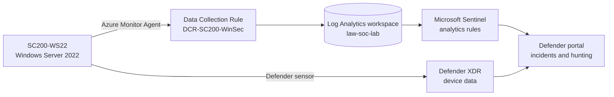

| Component | Detail |
|---|---|
| Target host | `SC200-WS22`, Windows Server 2022 Datacenter, Standard B2als_v2, India South Central |
| Workspace | `law-soc-lab` (Log Analytics with Microsoft Sentinel) |
| Log collection | Azure Monitor Agent with the data collection rule `DCR-SC200-WinSec`, "Common" Windows security event set |
| Endpoint protection | Defender for Servers Plan 2, host onboarded to Defender for Endpoint |
| Access control | RDP allowed from one source IP through a dedicated network security group rule |

---

## Step 1: The test computer and a locked door

I created a Windows Server 2022 virtual machine named `SC200-WS22`. It is small on purpose: 2 vCPUs and 4 GiB of memory is plenty for a lab.

Then I locked the door. Remote Desktop (RDP) is how you sign in to a server remotely, and bots on the internet try passwords against open RDP ports within hours. I created a network rule that allows RDP from **one address only**: mine.

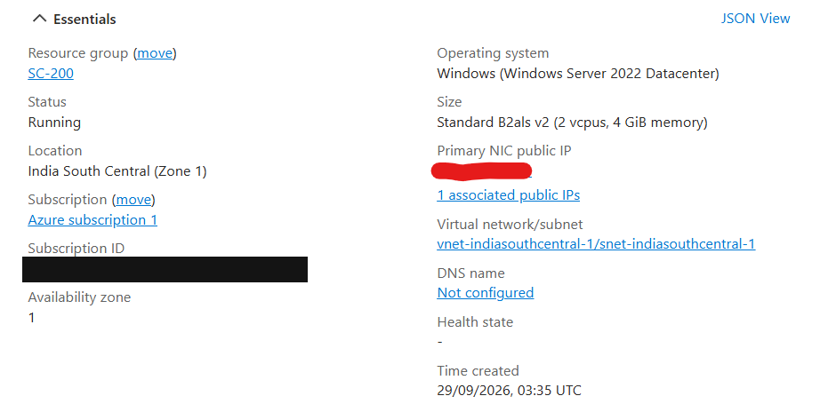
*The VM `SC200-WS22` running in Azure. Subscription details hidden.*

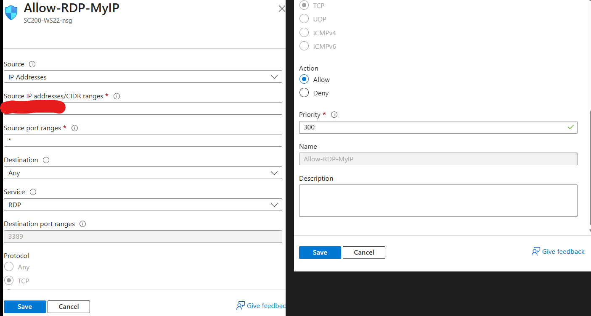
*The rule `Allow-RDP-MyIP`: RDP (port 3389) from one source address. My address is hidden.*

---

## Step 2: Sending logs to Sentinel

A server tells Sentinel nothing on its own. It has to send its logs. I set up two pieces:

- **Azure Monitor Agent:** a small helper program on the server that sends the logs.
- **Data Collection Rule:** a list of which logs to send and where. I chose the **Common** event set instead of **All events** to keep storage small.

The logs land in a Log Analytics workspace (`law-soc-lab`), which Sentinel reads from.

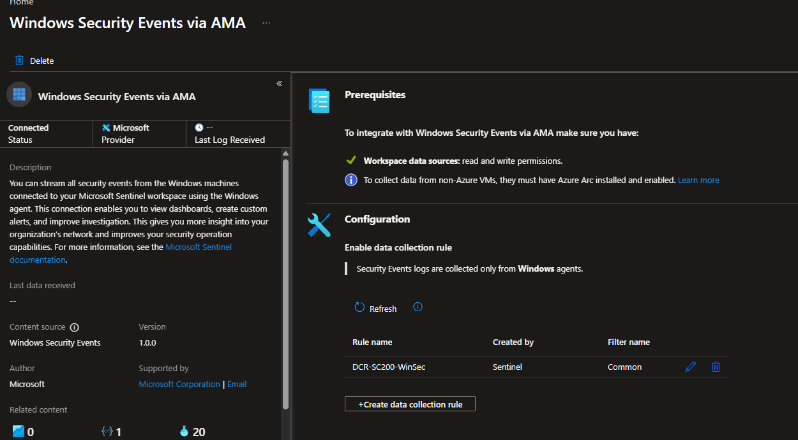
*The Windows Security Events connector shows Connected, with my data collection rule attached.*

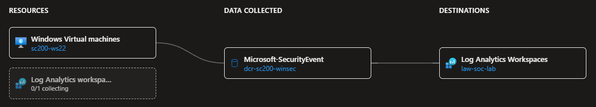
*The pipeline: the server, the data collection rule, and the workspace.*

I verified delivery with two KQL queries instead of assuming it worked:

```kql
SecurityEvent
| take 10

Heartbeat
| summarize LastSeen = max(TimeGenerated) by Computer
```

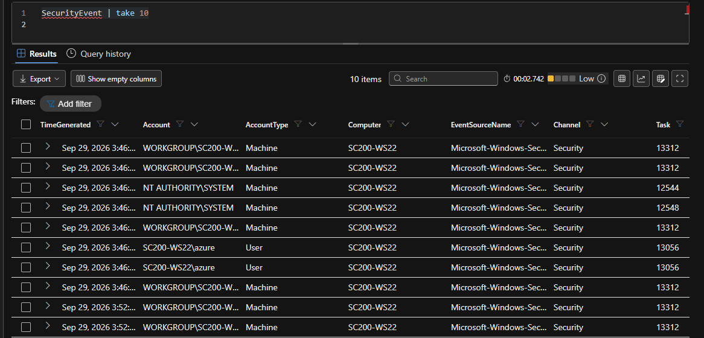
*Real security events from `SC200-WS22`.*

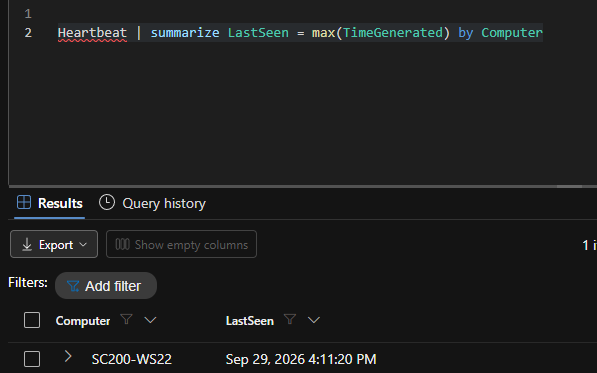
*The agent on `SC200-WS22` is reporting in.*

---

## Step 3: Adding Defender for Endpoint

Logs describe what happened. Defender for Endpoint also watches the machine itself. I turned on **Defender for Servers (Plan 2)** in Defender for Cloud and left every other paid plan off.

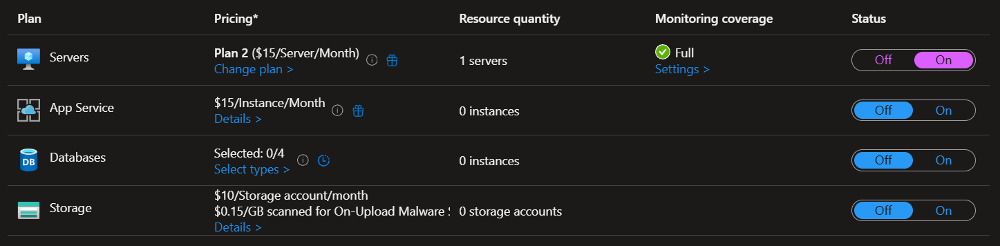
*Only the Servers plan is on.*

The sensor runs on the server, and `OnboardingState = 1` means it is connected. The server then appeared in Defender's device inventory.

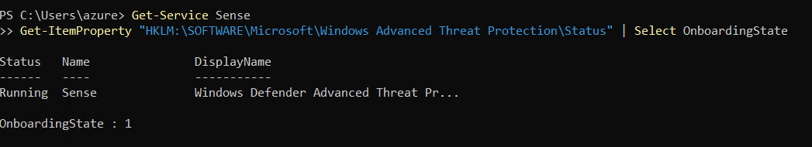
*The Defender sensor is running and onboarded.*

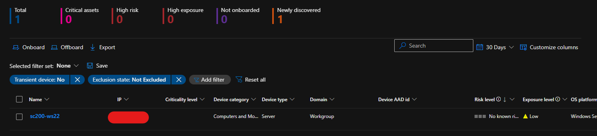
*`SC200-WS22` in the Defender device inventory: a Windows Server, no known risk, low exposure.*

I put the server in a device group, `SC200-Lab-Servers`, with the remediation level **Semi - Approval required for all folders**. Defender can investigate on its own, but it has to ask before it fixes or deletes anything.

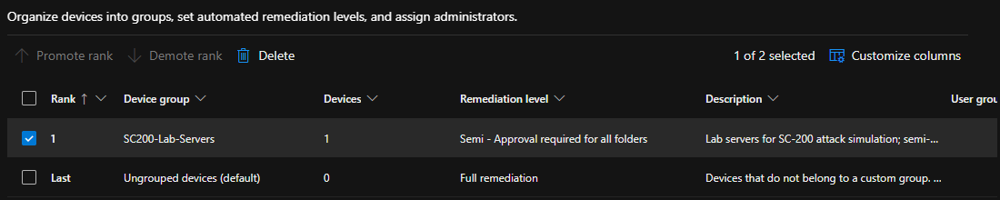
*The device group has one device and requires approval for remediation.*

---

## Step 4: Writing two detection rules

A detection rule is a saved search that runs on a timer. When it finds a match, it raises an alert, and Sentinel groups alerts into incidents.

| Rule | What it looks for | Severity | MITRE | Runs |
|---|---|---|---|---|
| SC200 - Brute force failed logons | The same account failing to sign in 5 or more times in 10 minutes (event 4625) | Medium | Credential Access (T1110) | Every 5 min |
| SC200 - New local admin created | A new local account (event 4720) or a member added to Administrators (event 4732) | High | Persistence (T1136.001) | Every 5 min |

Both rules use **entity mapping**, which tells Sentinel which fields are a computer (Host) and which are an account (Account). That is what lets the incident view show who and what was involved.

**Rule 1**
```kql
SecurityEvent
| where EventID == 4625
| summarize Failures = count() by TargetUserName, Computer
| where Failures >= 5
```

**Rule 2**
```kql
SecurityEvent
| where EventID == 4720 or (EventID == 4732 and TargetUserName == "Administrators")
| project TimeGenerated, Computer, EventID, Activity, TargetUserName, SubjectUserName
```

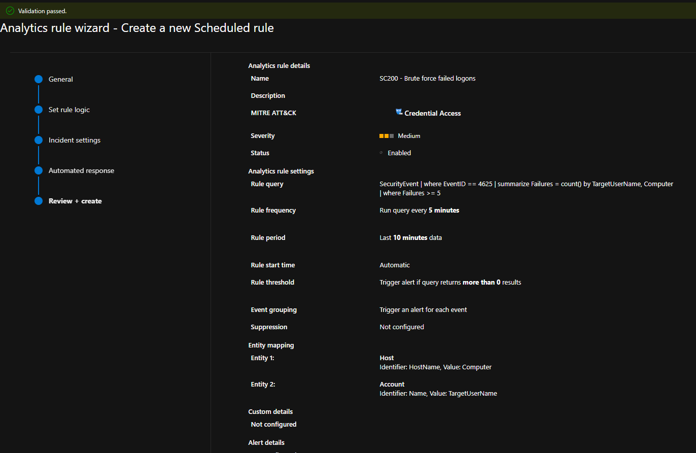
*Rule 1: every 5 minutes, 10-minute lookback, Host and Account mapped.*

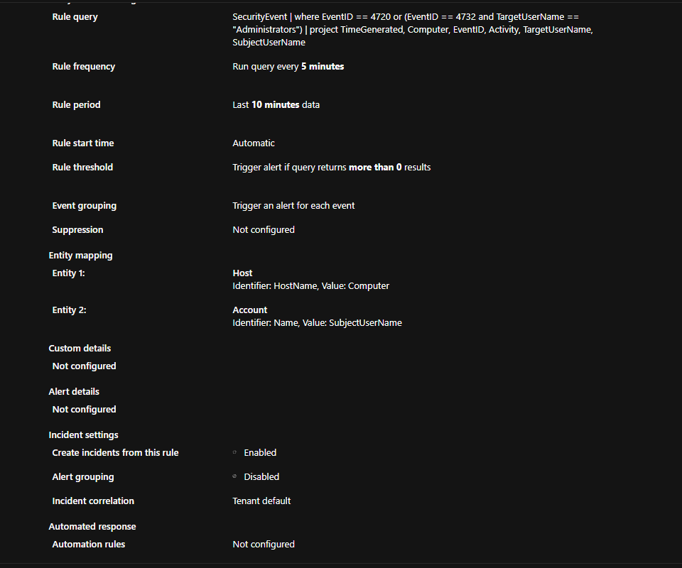
*Rule 2: the query, the schedule, and the entity mapping.*

---

## Attack 1: Guessing passwords

**Simulation.** From inside the server, eight failed sign-ins against an account that does not exist (`labfake`). This is the same pattern as password guessing (MITRE T1110).

```powershell
1..8 | ForEach-Object { net use \\localhost\IPC$ /user:labfake WrongPass$_ }
```

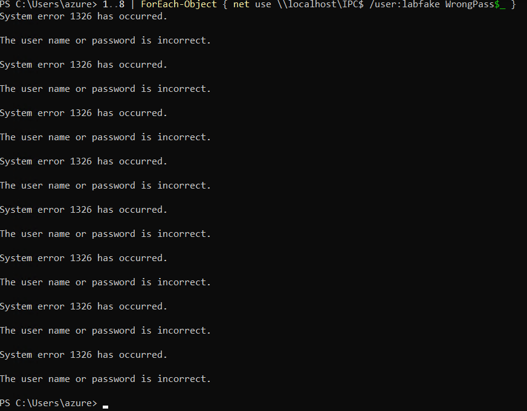
*Each attempt fails with error 1326.*

**Detection.** Windows logged each failure as event 4625. The rule then fired and Sentinel created a Medium severity incident.

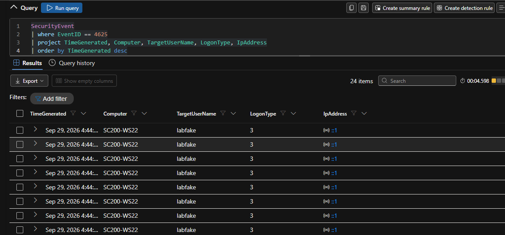
*The failed sign-ins: same account, same computer, logon type 3 (network).*

**Investigation**

- The alert named the right computer and account, and the failure count matched the test.
- The source address was `::1` (localhost). That makes sense, because I attacked from inside. A real attack from outside would show an external address.
- The Assets tab linked the host and account to the incident.

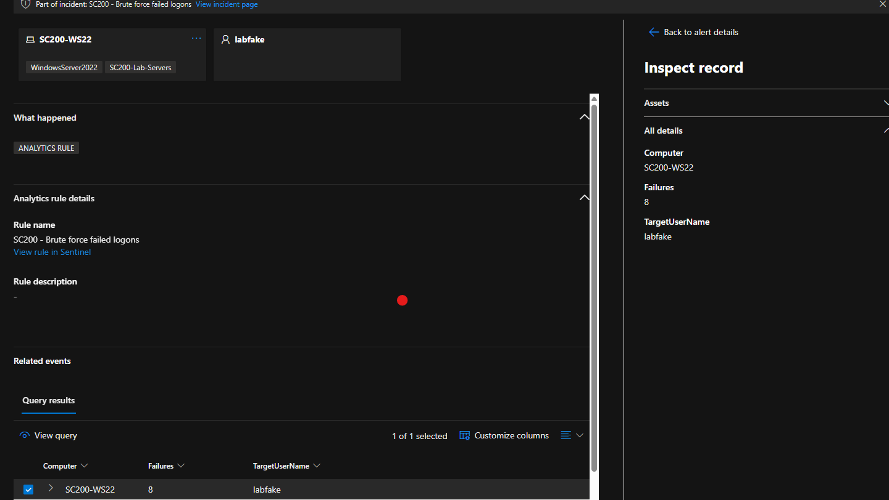
*The alert: the account `labfake`, the computer with its device-group label, and the failure count.*

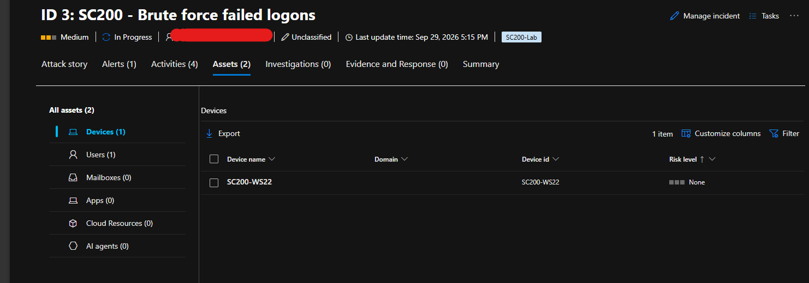
*The incident's Assets tab.*

**Closure.** I resolved the incident as **Informational, expected activity: Security testing** and wrote a comment explaining what it was.

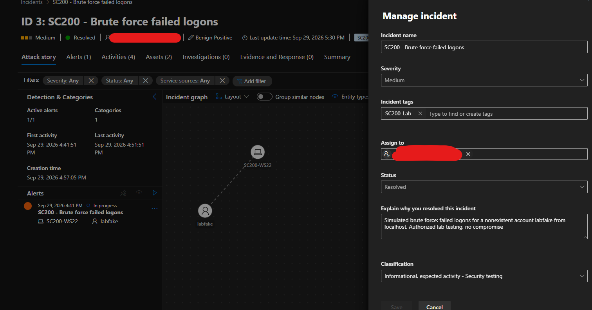
*The incident closed with its classification and explanation.*

---

## Attack 2: Creating a hidden admin account

**Simulation.** I created a local user (`labtemp`) and added it to the Administrators group. Attackers do this to keep a way back into a machine (MITRE T1136.001).

```powershell
net user labtemp <test-password> /add
net localgroup administrators labtemp /add
```

**Detection.** The second rule fired and created a High severity Persistence incident.

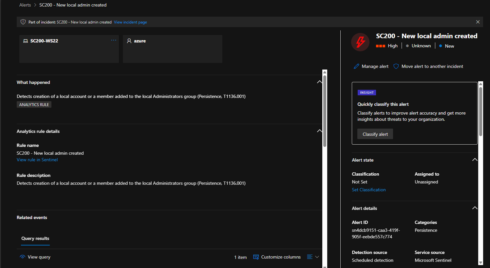
*The alert: High severity, Persistence, with the host and account.*

The evidence row showed event 4732 for the Administrators group, made by the account `azure`.

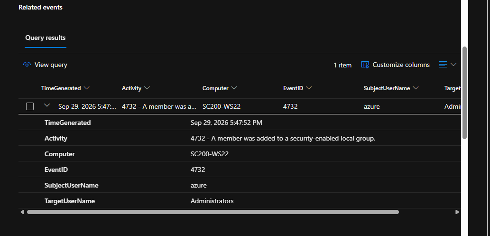
*The evidence: event 4732, group Administrators, performed by `azure`.*

**The puzzle.** The alert told me who made the change and which group, but not **which account was added**. I went to the raw logs.

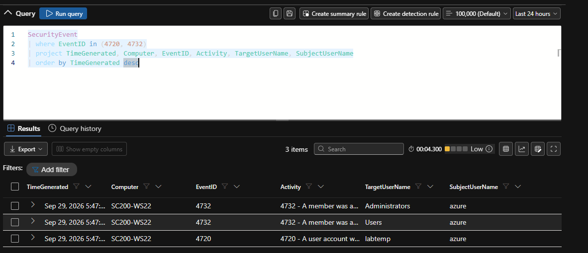
*One 4720 (account `labtemp` created) and two 4732 events. The second 4732 is for the Users group, which Windows adds every new account to by default.*

**The fix: join the events by SID.** Every Windows account has a unique SID. Event 4720 (account created) and event 4732 (added to a group) both carry it, so I joined them:

```kql
let created = SecurityEvent
    | where EventID == 4720
    | project NewAccount = TargetUserName, Sid = TargetSid;
SecurityEvent
| where EventID == 4732 and TargetUserName == "Administrators"
| project AddedTime = TimeGenerated, Computer, ActedBy = SubjectUserName, Sid = MemberSid
| join kind=inner created on Sid
| project AddedTime, Computer, ActedBy, NewAccount, Sid
```

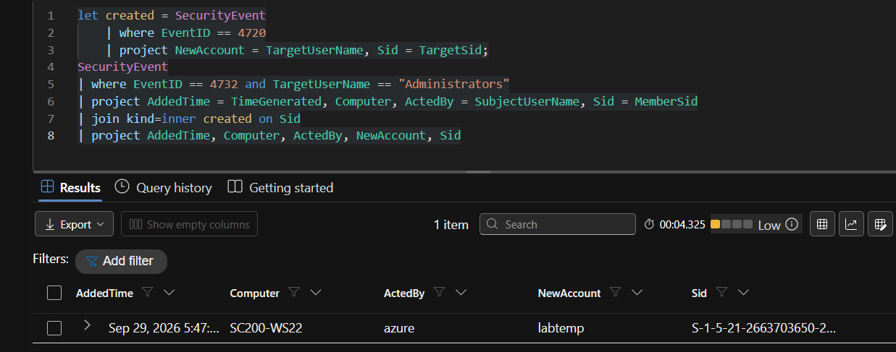
*The join returns one row that answers the question.*

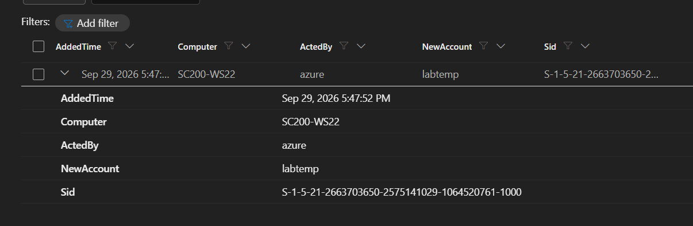
*The row expanded: `labtemp` was added to Administrators by `azure` on `SC200-WS22`.*

**Clean-up.** I closed the incident the same way as the first one, deleted the `labtemp` account, and checked the user list.

---

## Results

| Simulated technique | MITRE | Detected | How I confirmed it |
|---|---|---|---|
| Repeated failed logons against a fake account | T1110 | Yes | Sentinel alert and incident with the failure count in the evidence |
| Local account creation and admin group addition | T1136.001 | Yes | Sentinel alert and incident, then events 4720 and 4732 joined by SID |

Both simulated techniques produced alerts and incidents, and I investigated and classified each one.

---

## Lessons learned

- **Entity mapping decides how useful an incident is.** My first brute-force rule put the username inside the Host entity. Moving it to its own Account entity made the incident graph and Assets tab show the computer and the person correctly.
- **An alert is a starting point.** The admin alert did not name the new account. I had to hunt through the raw events to find it.
- **Evidence fields save time.** If rule 2 also output the member SID, the new account would show up in the alert itself.
- **Test traffic looks different from real traffic.** Attacking from inside the server showed `::1` as the source.
- **Repeating a test repeats the alerts.** Running the same attack several times created several alerts. Alert grouping is how a real team keeps that manageable.
- **Two tool families, two clock names.** Sentinel tables use `TimeGenerated`. Defender hunting tables use `Timestamp`.

---

## Cost and safety

- RDP is restricted to a single source address.
- The data collection rule collects the **Common** event set, not everything.
- Only one paid Defender plan (Servers) is enabled.
- The VM is **deallocated** after every session, so Azure stops charging for compute.

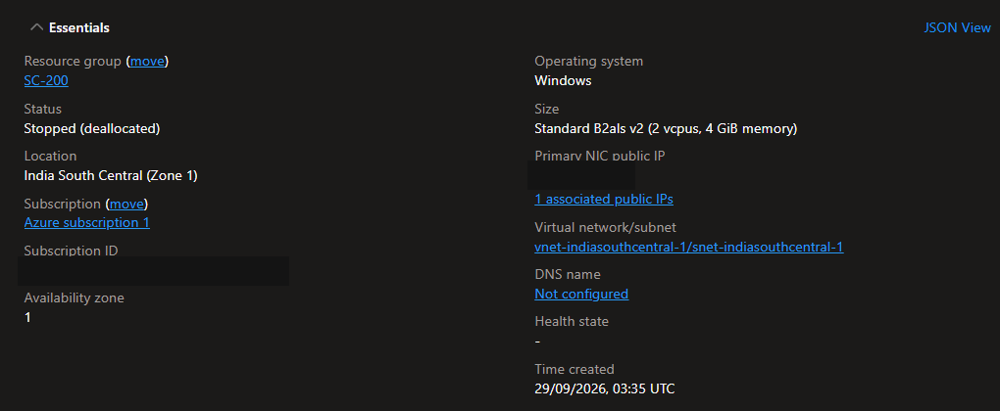
*The VM shown as Stopped (deallocated). Subscription ID and public address hidden.*

The attack simulations are standard, harmless test actions run on an isolated VM in my own Azure subscription.

---

## SC-200 skills practised

| Exam domain | What this lab covers |
|---|---|
| Manage a security operations environment | Data collection rules and Azure Monitor Agent, Log Analytics workspace, scheduled analytics rules with MITRE and entity mapping, Defender for Servers, Defender for Endpoint onboarding, device groups and remediation levels |
| Respond to security incidents | Triaging Sentinel incidents: reading alerts, assets and evidence, assigning, commenting, classifying, and closing |
| Perform threat hunting | KQL in Sentinel Logs and Advanced hunting: aggregating failed logons, inspecting raw events, and joining events by SID |

---

## Try it yourself

You will need an Azure subscription with permission to create resources.

1. Create a Windows Server 2022 VM. Allow RDP only from your own IP.
2. Create a Log Analytics workspace and enable Microsoft Sentinel.
3. Install the **Windows Security Events** solution, then create a data collection rule using the **Common** set and attach the VM.
4. Check the data with the queries in [`queries.kql`](queries.kql).
5. Create the two analytics rules from the [rule logic above](#step-4-writing-two-detection-rules), with Host and Account entity mapping.
6. Inside the VM, run [`scripts/attack-sim.ps1`](scripts/attack-sim.ps1) as administrator:
   ```powershell
   .\attack-sim.ps1 -Technique BruteForce
   .\attack-sim.ps1 -Technique LocalAdmin
   .\attack-sim.ps1 -Technique LocalAdmin -Cleanup
   ```
7. Wait 5 to 10 minutes, then triage the incidents in the Defender portal.
8. Deallocate the VM when you are done.

[`scripts/lab-control.sh`](scripts/lab-control.sh) is an optional Azure CLI helper that starts and stops the VM, updates the RDP rule with your current IP, and runs KQL against the workspace.

Only run the simulations on a machine you own and control.

---

## Repository layout

```
Sentinel-SOC-Lab/
├── README.md
├── Sentinel-SOC-Lab-Walkthrough.pdf   Illustrated walkthrough in plain language
├── queries.kql                        KQL used in the lab
├── scripts/
│   ├── attack-sim.ps1                 Attack simulations with cleanup (run inside the lab VM)
│   └── lab-control.sh                 Azure CLI helper for the lab VM
└── screenshots/                       Evidence images used in this README
```
